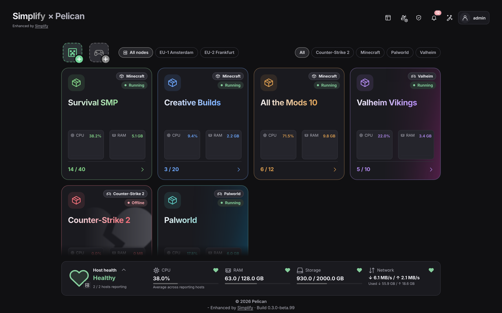
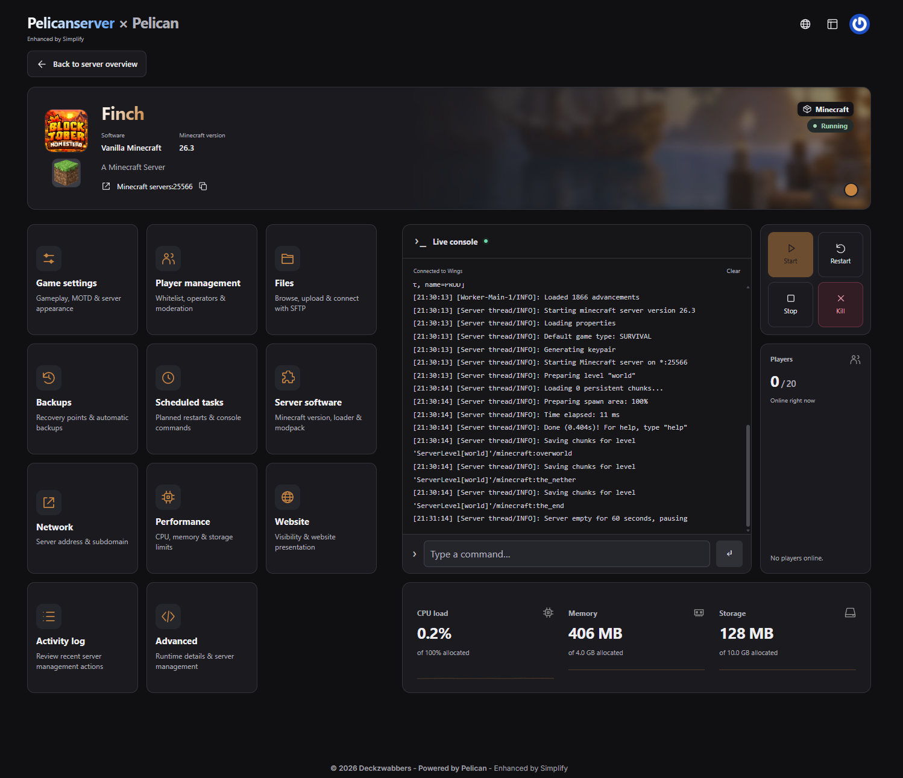
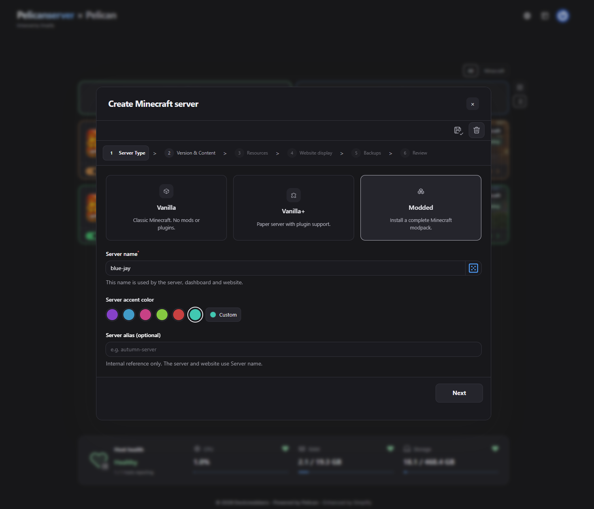

# PelicanSimplify

> [!WARNING]
> This plugin is imagined, designed and tested by me, but used an AI for coding.
>
> Create backups before installing and expect bugs and/or errors, especially in the alpha builds. Plugin is made to work on top of your panel so it won't interfere with the running servers. It runs fine for me, but that's no guarantee.

A fresh interface for Pelican, with simpler server management and guided server creation.

**Alpha · Pelican 1.0.0-beta38 · PHP 8.3+**

## Highlighted features

- **UI overhaul** — a unified server overview, dashboard and live console.
- **Guided server creation** — choose your game or modpack; Simplify selects the matching egg automatically.
- **Friends mode** — see every server, manage only those you own or are assigned to.
- **Make it yours** — light/dark themes and shared or individual server accent colors.

## Screenshots

## Getting started

Use **Admin → Plugins → Import from URL** with the [latest plugin ZIP](https://raw.githubusercontent.com/jerajerajerajera/PelicanSimplify/main/dist/pelican-simplify-latest.zip), click **Install**, then complete the setup checks. Missing dependencies block installation or setup and show how to fix them. Node.js 22.12+ or 24+, Yarn, a running queue worker and scheduler are required.

For migration from the standalone creator, see [installation notes](docs/INSTALLATION.md). This alpha still needs testing on a real Pelican/Wings installation. Report problems through [Issues](https://github.com/jerajerajerajera/PelicanSimplify/issues).

## Coming features

Planned improvements; scope and release order may change.

- **Other game server creation** — guided setup and automatic egg selection for more games.
- **Egg settings in the dashboard** — edit supported startup variables with clear descriptions and validation.
- **Dashboard alerts** — warnings for crashes, resource limits and failed backups.
- **Known server startup fixes** — detect common startup problems and offer guided fixes.
- **Server presets** — reusable settings for faster, consistent server creation.
- **Troubleshooting reports** — export useful diagnostics with secrets removed to make support easier.

## Full feature list

- **Overview:** grid/list views, game filters, saved desktop preferences, mobile list view, server status, player counts, CPU/RAM graphs and host health.
- **Dashboard:** server banners and artwork, game/version details, live console, start/restart/stop/kill controls, resource metrics and player list.
- **Creation:** guided Minecraft creation and native other game creation, Vanilla/Paper/modpacks, automatic egg selection, bundled egg import, game/version selection, bird-name generator, server colors, saved drafts, configurable CPU/RAM/disk defaults per type, resource limits and review before creation.
- **Minecraft:** Modrinth, CurseForge, FTB and supported Technic packs; software/version changes, game settings, MOTD, whitelist, operators and player moderation.
- **Management:** files and SFTP, mods/plugins, backup recovery points, automatic backup policies and retention, schedules, activity and advanced workspaces, subject to native Pelican permissions.
- **Appearance:** light/dark/system theme, shared styling, optional legacy styling, always-dark or adaptive console, panel accent, automatic individual server colors and a built-in backgrounds, uploaded server banners and banner library management.
- **Access:** switchable Friends mode, administrator settings, individual user-feature switches, optional self-service creation and per-user server/resource allowances.
- **Setup:** PHP/extensions, Composer and icons, Node/Yarn, writable storage, database/cache, queue configuration and validation of compiled CSS/JavaScript; failed checks block progress and can be rerun.

MIT licensed. Bundled game eggs retain their upstream licenses.
