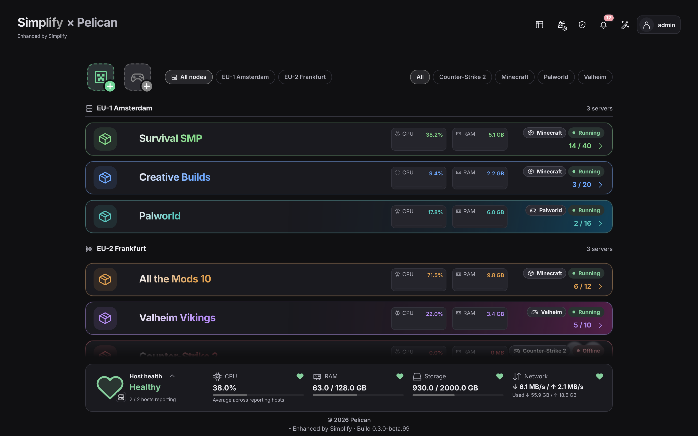

# PelicanSimplify (pt-BR)

Uma interface mais limpa e simples para o painel de servidores de jogos [Pelican](https://github.com/pelican/panel). Você gerencia seus servidores a partir de uma visão geral e cria novos com um assistente guiado. Tudo continua rodando no Pelican e no [Wings](https://github.com/pelican/wings), e o painel original continua disponível.

**Baseado no 0.4.2-beta.7 · Pelican 1.0.0-beta38 e 1.0.0-rc.1 · PHP 8.3+**

## Sobre este fork

Este repositório é um fork do [PelicanSimplify original](https://github.com/jerajerajerajera/PelicanSimplify), criado por jerajerajerajera e distribuído sob a licença MIT. Ele acrescenta:

- **Português (Brasil):** o plugin inteiro segue o idioma escolhido no perfil de cada usuário do Pelican. As notificações chegam no idioma de quem as recebe.
- **Tamanho da interface:** tamanho do texto e tamanho dos elementos, com um padrão definido pelo administrador e uma escolha pessoal por dispositivo em Personalizar, separada para o modo simples e o modo host.
- **Atualizações por este fork:** o plugin busca as atualizações aqui, então uma versão do original não substitui a versão traduzida.

As versões deste fork terminam em `-ptbr.N` (por exemplo, `0.4.2-beta.7-ptbr.8`). O histórico de mudanças está no [CHANGELOG](CHANGELOG.md) (em inglês).

*As capturas de tela usam servidores de exemplo e mostram a interface em inglês.*

## Destaques

- **Uma visão geral de todos os servidores:** status ao vivo, jogadores, CPU e RAM num relance, em grade ou em lista.
- **Criação guiada de servidores:** escolha Minecraft (Vanilla, Paper ou um modpack) ou procure entre mais de 170 outros jogos; o Simplify escolhe e instala o egg certo.
- **Modo simples e modo host:** o modo simples serve para poucos servidores. O modo host acrescenta uma lista de servidores por node e as páginas de administração lado a lado, para hospedagens maiores.
- **Do seu jeito:** temas claro e escuro, cores por servidor, banners e o seu próprio logo ou nome do painel estilizado.
- **Modo amigos, pessoas e funções:** todos veem todos os servidores, mas só gerenciam os próprios, e as funções definem permissões e limites claros.

## Antes de instalar

O Simplify muda bastante a aparência e o funcionamento do painel. Leia isto primeiro.

- **Ele substitui boa parte do painel.** A visão geral, as páginas de servidor e a criação de servidores passam a ser do Simplify. Opcionalmente, ele também assume as páginas de Usuários, Funções e Plugins, e os administradores podem usar o modo host.
- **Tudo pode ser desligado.** Cada parte tem a sua própria chave nas configurações do Simplify, e você pode desligar o dashboard do Simplify inteiro. O painel original do Pelican continua sempre disponível: os links "Legado" em Ferramentas de administração levam até ele, e mesmo que você esconda esses links as páginas continuam funcionando.
- **Ele não mexe nos servidores em execução.** Servidores, eggs, nodes e permissões continuam sendo do Pelican. O Simplify é outra forma de vê-los e gerenciá-los.
- **Outros plugins têm suporte parcial dentro do Simplify.** Eles continuam funcionando no painel original do Pelican. Nesta versão, as páginas de administração e de servidor deles aparecem em "Externo". Widgets e blocos de outros plugins ainda não são suportados. O suporte completo a plugins é o primeiro item do roadmap (veja Próximos recursos).
- **Faça um backup antes de instalar**, como com qualquer plugin que muda tanta coisa.

## Primeiros passos

1. No Pelican, vá em **Admin → Plugins → Importar de URL**.
2. Cole o link da versão mais recente deste fork e clique em **Instalar**:

   `https://raw.githubusercontent.com/Majozin/PelicanSimplify/main/dist/pelican-simplify-beta-latest.zip`

3. Siga as verificações de instalação. O que estiver faltando aparece com a explicação de como resolver.
4. No seu perfil do Pelican, escolha o idioma **Português (Brasil)**.

**Requisitos:** Node.js 22.12+ ou 24+, Yarn, e um worker de fila e o agendador em execução.

**Atualizações:** o Simplify se atualiza pelo próprio gerenciador de plugins, com backup e reversão automática se algo falhar. Você sempre recebe a build feita para a sua versão do Pelican. Este fork publica as versões traduzidas no canal beta, então ative **"Receber versões beta do Simplify"** em Configurações do Simplify → Gerenciador de plugins.

Vindo do criador avulso? Veja as [notas de instalação](docs/INSTALLATION.md). Encontrou um problema na tradução ou nas mudanças deste fork? Abra uma [issue aqui](https://github.com/Majozin/PelicanSimplify/issues). Problemas do plugin em si também podem ser relatados no [projeto original](https://github.com/jerajerajerajera/PelicanSimplify/issues).

## Próximos recursos

Este é o roadmap do projeto original; a ordem e o escopo ainda podem mudar. Tudo o que o Simplify ainda não cobre continua disponível no painel original do Pelican.

### Prioridade máxima: suporte a plugins

O Simplify deve funcionar junto com os outros plugins do Pelican, e não ao lado deles:

- Páginas e configurações de outros plugins instalados aparecem dentro do Simplify (menu de administração, modo host e páginas de servidor), no mesmo estilo.
- Plugins podem adicionar os próprios blocos ao painel do servidor.
- Plugins são instalados, atualizados e ligados ou desligados pelo gerenciador de plugins do Simplify.

O suporte a plugins também é o que torna possível o passo seguinte: deixar o Simplify substituir o painel original por completo.

### Em seguida

- **Uma experiência de verdade no celular.** Todas as páginas pensadas para uma mão só: barra de abas embaixo, telas cheias no lugar de janelas, console e botões de energia adequados ao celular, e o Simplify instalável como app na tela inicial.
- **Uma página de servidor melhor.** Uma barra de status clara no topo, um console com o espaço que precisa, áreas de trabalho que abrem dentro da página em vez de janelas, e um só lugar para tudo o que precisa da sua atenção.
- **O Simplify como painel inteiro.** Uma opção na instalação que torna o Simplify o único painel. O original continua acessível em `/legacy`, ou é desligado de vez quando nenhum outro plugin precisa dele.
- **Instalação de servidores mais clara.** Um único estado "configurando…" até o servidor novo ficar pronto, e o EULA do Minecraft aceito logo no começo, sem ciclo de reinício.
- **Criação de servidores melhor para todos os jogos.** Recursos recomendados por jogo e um cartão de progresso da instalação.
- **Configurações do egg no dashboard.** Configurações de inicialização para todos os jogos, com descrições simples e verificações.

### Mais adiante

- **Alertas** para travamentos e servidores ficando sem recursos.
- **Correções de inicialização:** reconhecer problemas comuns de inicialização e oferecer correção com um clique.
- **Predefinições de servidor:** salvar configurações uma vez e reutilizá-las em servidores novos.
- **Relatórios de diagnóstico:** exportar diagnósticos sem nenhum segredo, para facilitar o suporte.
- **Mais opções na visão geral:** campos de informação e layouts extras.

Veja o [roadmap](docs/ROADMAP.md) do projeto original para mais detalhes.

## Todos os recursos

Os itens marcados com *(Pelican)* são recursos que já existem no Pelican ou no Wings e que o Simplify mostra na própria interface. Todo o resto é acrescentado pelo Simplify.

<strong>Visão geral e modo host</strong>

- Visualização em grade ou lista, lembrada por usuário; no celular, a lista é usada automaticamente
- Nome, apelido, ícone, jogo e status ao vivo *(Pelican)* do servidor, jogadores, e gráficos de CPU e RAM
- Filtro por jogo; servidores agrupados por node quando há mais de um
- Botões rápidos de iniciar, parar e reiniciar em cada servidor
- Painel de saúde por node: CPU, RAM, disco e rede, com aviso quando algo está errado
- **Modo host:** uma lista de servidores por node, as páginas de administração no meio, e servidores que abrem ao lado da lista

<strong>Criação de servidores</strong>

- **Criador fácil de servidor Minecraft:** um assistente passo a passo para Vanilla, Paper e modpacks (Modrinth, CurseForge, FTB e Technic)
- **Criador fácil de servidor:** procure entre mais de 170 jogos dos eggs oficiais do Pelican; eggs que faltam são instalados automaticamente
- Banners e ícones da Steam para os jogos, e tokens de servidor de jogo da Steam automáticos para os jogos que precisam de um
- Predefinições de recursos, limites por usuário, gerador de nomes *(Pelican)*, e escolha de cor e ícone do servidor
- Rascunhos salvos automaticamente, que podem ser descartados
- **Subdomínios automáticos** *(complemento, Cloudflare)*: escolha um nome como `oak` no criador ou na seção Rede do servidor; o Simplify cria os registros DNS (um CNAME, e um registro SRV para que jogadores de Minecraft não precisem digitar a porta) e os remove junto com o servidor
- O criador do próprio Pelican continua disponível

<strong>Gerenciando um servidor</strong>

- Console ao vivo com histórico de comandos *(Pelican)*
- Controles de energia e uso de recursos *(Pelican)*
- Configurações do Minecraft com prévia do MOTD ao vivo: jogadores, dificuldade, modo de jogo, PvP, whitelist e mais
- Gerenciamento de jogadores: whitelist, operadores, expulsões e banimentos
- Plugins e mods do Modrinth: procurar, instalar, atualizar e remover
- Troca de software, versão ou modpack, exigindo antes um backup recente
- Arquivos, agendamentos, registro de atividades, bancos de dados e dados de SFTP *(Pelican)*
- Mudanças que exigem reinício ficam reunidas, com a opção de reiniciar agora ou depois

<strong>Backups</strong>

- Backups automáticos com intervalo e retenção definidos por você, e um botão de pausa
- Um backup que falha nunca remove o último backup bom
- Restaurar e baixar *(Pelican)*

<strong>Aparência</strong>

- Tema claro, escuro ou do sistema
- Uma cor de destaque para o painel inteiro, ou uma cor por servidor
- Banners: arte do Minecraft incluída, arte da Steam ou os seus próprios envios
- Nome e logo do painel: envie um logo ou estilize o nome com a sua fonte e as suas cores
- Tamanho do texto e dos elementos, com escolha pessoal por dispositivo *(este fork)*
- A mesma barra de salvar em todas as páginas de configuração

<strong>Pessoas, acesso e configurações</strong>

- **Modo amigos:** veja todos os servidores, gerencie só os seus ou os compartilhados com você *(permissões do Pelican)*
- **Pessoas e funções:** adicione pessoas com convite por e-mail, e crie funções com permissões do Simplify, limites e acesso de administração
- Ligue ou desligue recursos individuais para os usuários: arquivos, backups, agendamentos, jogadores, plugins e mais
- Criação de servidores por conta própria opcional, com limites por função ou por pessoa
- Conta Steam na página de perfil para os tokens de servidor de jogo

<strong>Instalação e manutenção</strong>

- Instala pela importação de plugins do próprio Pelican *(Pelican)*
- Verificações de PHP, Node.js, banco de dados, fila, armazenamento e limites de envio, cada uma com instruções de correção
- Gerenciador de plugins com atualizações seguras: backup antes, verificação de checksum e reversão automática se uma atualização falhar
- Atualizações automáticas de plugins opcionais

## Como este projeto é feito

O PelicanSimplify foi idealizado e projetado por jerajerajerajera, autor do projeto original: o que ele faz, como ele parece e como deve funcionar. O código é escrito junto com um assistente de IA. Cada mudança é verificada e testada antes de ser lançada: testes automatizados rodam em cada build, cada mudança é experimentada numa instalação de teste do Pelican e testada no painel do próprio autor. As mudanças deste fork seguem o mesmo processo e são validadas num painel real. Ainda assim, é um projeto jovem: espere um bug ou outro, principalmente nas versões beta, e relate o que encontrar pelas [issues](https://github.com/Majozin/PelicanSimplify/issues).

Licença MIT (veja [LICENSE](LICENSE), com o aviso de copyright original). Os eggs de jogos incluídos mantêm as suas licenças originais.
